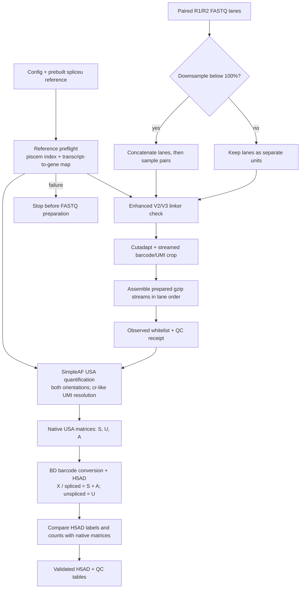

# Rhapsodist + SimpleAF

Prepare BD Rhapsody Enhanced V2/V3 whole-transcriptome reads and quantify spliced, unspliced and ambiguous counts for RNA-velocity workflows. The pipeline ends with validated count matrices; it does not estimate velocity, annotate cells or merge the original BD expression matrix.

## Workflow

The diagram shows the path from paired FASTQs and a prebuilt spliceu reference to the validated H5AD. Downsampling is optional; lanes otherwise stay separate through preparation.



## Count and barcode contract

SimpleAF uses geometry `1{b[27]u[8]}2{r:}`, both read orientations and `cr-like` UMI resolution. The config value `resolution: usa` selects the USA output contract; it is not the SimpleAF UMI-resolution flag.

| Output | Contents |
|---|---|
| Native SimpleAF | Separate spliced (S), unspliced (U) and ambiguous (A) matrices |
| H5AD `X`, `layers['spliced']` | S + A |
| H5AD `layers['unspliced']` | U |
| H5AD `obs_names` | Decimal BD cell index by default |
| H5AD `obs` | Original 27-nt barcode, integer BD cell index and sample |
| H5AD `var` | Original Ensembl IDs/order; reference gene symbols when available |

Quantification uses the observed barcode whitelist with `--unfiltered-pl --min-reads 1`. The whitelist contains prepared-R1 barcodes valid across the ordered BD 384×3 panels; export applies no further barcode correction or cell/gene filtering. It retains zero-count rows/columns and fractional estimates. BD cell identifiers are sample-local: join captures using both `sample` and the cell identifier. An optional `bd_reference` list/TSV checks names but does not import BD expression counts. See [barcode conversion](workflow/scripts/bd_barcode_conversion.py).

## Configure and run

Copy [configs/velocity.yaml](configs/velocity.yaml) and replace its WTA1 paths with paths accessible inside the container. Provide paired R1/R2 file lists in the same lane order, unique safe sample names, `bead_chemistry: enhanced_v2` or `enhanced_v3`, `allowedlist: 384`, `diversity_insets: 'yes'`, `simpleaf.resolution: usa`, and a prebuilt spliceu index. Set `downsample` in `(0, 100]`; the default, 100, keeps all read pairs. The workflow does not build or modify the reference.

Reference preflight checks the piscem index, `t2g_3col.tsv` and any supplied identity manifest before FASTQ preparation. A manifest is optional; without one, genome and release provenance are recorded as unknown. See [reference validation](workflow/scripts/simpleaf_quant.py).

Build a new image with Apptainer, fakeroot and Pixi available:

```bash
./container_build.sh "$PWD/rhapsodist-simpleaf.performance.sif"
```

The build script uses the lockfile, runs development checks and writes a checksum. It refuses to overwrite an existing image. The current cluster SIF predates the FASTQ-QC changes; build under a new name and update the image path before submitting a job.

Review the DAG with a dry run from a Slurm allocation (at least two CPU cores):

Copy the built image and sample config to the paths in the command, then run:

```bash
apptainer exec --cleanenv --bind /globalscratch \
  /globalscratch/tsirchi/cemlab/simpleaf/containers/rhapsodist-simpleaf.performance.sif \
  rhapsodist --configfile /globalscratch/tsirchi/cemlab/simpleaf/configs/my_sample.yaml \
  --cores "${SLURM_CPUS_PER_TASK:-16}" --resources mem_mb=64000 --dry-run
```

Remove `--dry-run` to execute. Use a fresh `working_dir` after changing workflow code or configuration; Snakemake may invalidate downstream results. Rules run inside the single container. The supplied [Slurm script](slurm/velocity.sbatch) still names the older image and needs updating.

## Outputs and quality checks

`working_dir` contains persistent prepared FASTQs, the observed whitelist, logs, native USA output, one `{sample}_velocity.h5ad`, and QC tables. Prepared lane units are temporary and removed after successful ordered assembly; completed prepared reads remain so quantification can be retried. Use Snakemake's `--rerun-incomplete` for interrupted outputs.

Routine QC validates prepared R1 structure and barcode/UMI length, checks Cutadapt pair counts, and records a receipt bound to sample, input paths, sizes and modification times. The default does not reread all prepared R2 records to independently check gzip integrity. Set `fastq_qc_exhaustive: true` for a full mate/structure/gzip scan; it can take hours. Linker classification samples a bounded number of reads, not every read. File identity metadata is not a content checksum.

The H5AD is checked against native USA cell/gene order and S+A/U values before publication. See the [performance audit](PERFORMANCE_AUDIT.md) for QC limits, recovery behavior, resources and recorded fixture results. Fixture and synthetic checks are not production-sample or Slurm performance evidence.

## Reproducibility

The run records workflow, config, lockfile, reference and QC-receipt provenance in native output and H5AD metadata. Small reference files are hashed; the large index and FASTQs are not content-hashed. See [pixi.toml](pixi.toml), [pixi.lock](pixi.lock), and the [container definition](rhapsodist.def) for pinned software and image inputs.

Preparation follows [imallona/rhapsodist at commit 7991f870fdfe38e12648673d330cbfd4839e755d](https://github.com/imallona/rhapsodist/tree/7991f870fdfe38e12648673d330cbfd4839e755d), under GPL-3.0; see [LICENSE.txt](LICENSE.txt) and [AUTHORS.txt](AUTHORS.txt). Documentation guidance: Kassis T, Agarwal V, He Y, Patel D, Brueckner AM (2026), [Scientific Agent Skills](https://doi.org/10.48550/arXiv.2609.00065).
